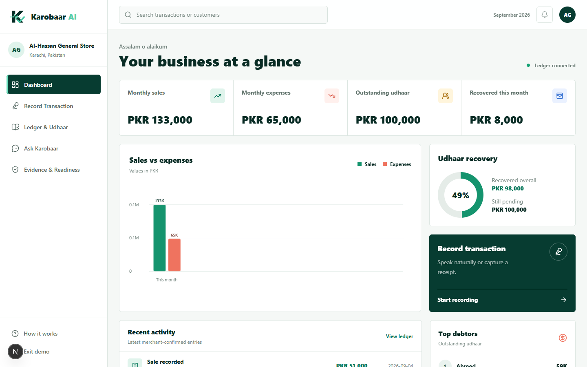
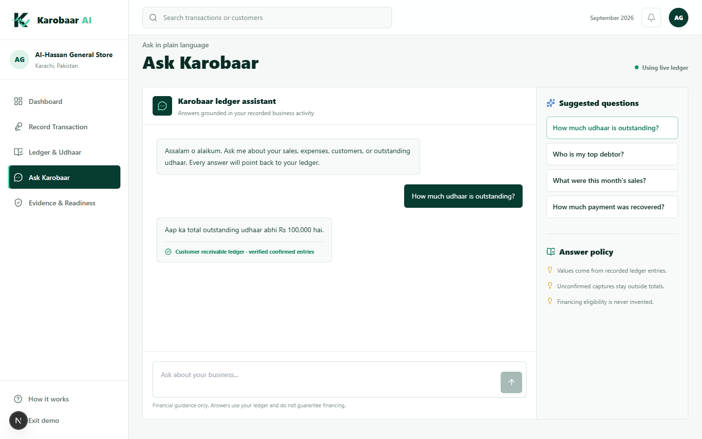
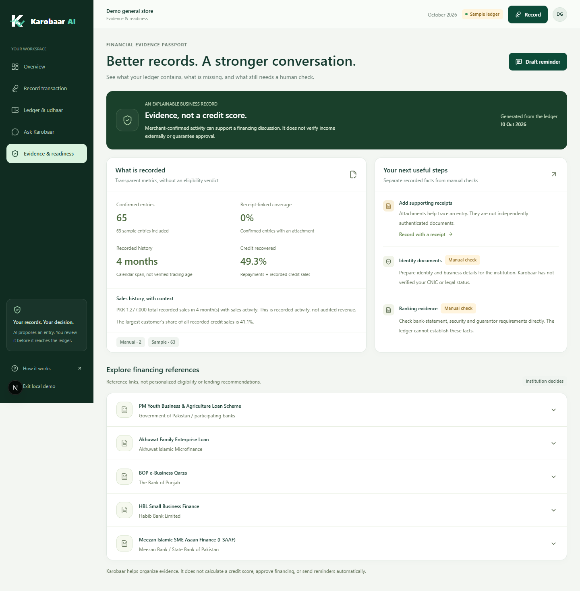

# Karobaar AI

**Voice-first financial evidence and decision support for Pakistan's informal merchants.**


Karobaar turns a merchant's voice notes and receipt photos into a reviewable financial draft. Nothing reaches the ledger until the merchant confirms it. Once confirmed, deterministic ledger logic—not an LLM—computes sales, expenses, udhaar, recoveries and evidence metrics. Manual entry provides a practical fallback when capture is unavailable.

Built for the Alibaba Cloud AI Hackathon Pakistan 2026, Financial Inclusion track.

[Open the hosted app](https://project-4ps4k.vercel.app/) — requires a merchant account. Both services are deployed. Real sign-in, synthetic receipt extraction/confirmation/reopening, repayment and ledger-grounded answers have been checked. Capture now routes to real APIs without Demo substitution. Human microphone/photo rehearsal and multi-account checks remain tracked in the [implementation ledger](docs/REGIONAL_ROUND_IMPLEMENTATION_LEDGER.md), not implied by the link alone.

## What we built

| Capability | Working implementation |
|---|---|
| Voice and receipt capture | AI produces a structured draft for merchant review |
| Confirmed ledger | Sales, expenses, udhaar and repayments enter only after confirmation; searchable transactions and full-history customer balances |
| Business dashboard | Clearly scoped monthly totals, recorded-month trend, receivables and recovery figures |
| Ask Karobaar | Five read-only ledger tools; guarded intent/month selection, deterministic answers, visible period and interpretation labels |
| Evidence Passport | Recorded evidence metrics with clear gaps and no invented score |
| Financing references | Five official reference links and manual next steps; no invented sales/history/receipt qualification thresholds |
| Reminder action | An editable, ready-to-copy udhaar reminder using the real customer balance |

Live capture uses real APIs only: Groq Qwen for text/receipt vision and Whisper for multilingual speech, with Gemini fallback. Missing keys, quota limits or outages produce a specific, safe error—not a canned draft. Retry reuses the selected capture. The review shows the actual provider, voice transcript and AI uncertainty notes. A generic bank transfer is not automatically classified as an udhaar repayment; unclear details require merchant review. Offline AI fixtures exist only for isolated tests; the public sample preview and seed/reset API have been removed.

## Product preview



<details>
<summary>More product screenshots</summary>

### Ask Karobaar



### Financial Evidence Passport



</details>

The submission deck is available at [`docs/Karobaar_AI_Hackathon_Presentation.pptx`](docs/Karobaar_AI_Hackathon_Presentation.pptx).

## Why it matters

Many micro-businesses have rich commercial activity, but it lives in memory, paper receipts, and chat threads. Karobaar helps a merchant build a reviewable business history without pretending to make a lending decision.

> **AI proposes a draft. The merchant confirms it. The ledger computes the totals.**

## Merchant workflow

1. Record a sale, expense, udhaar entry, or repayment by voice, receipt or manual entry.
2. Review the extracted draft and explicitly confirm it.
3. See deterministic dashboard and ledger totals.
4. Ask a natural-language question such as “Total udhaar kitna hai?”
5. Review the Financial Evidence Passport, evidence gaps and official financing reference links.
6. Draft a payment reminder; the merchant chooses whether and where to send it.

Karobaar does **not** calculate a credit score, approve a loan, or send WhatsApp/SMS messages automatically.

## Architecture

```text
Next.js web app
      |
      v
FastAPI API + verified Supabase identity
      |
      +--> Real AI adapter (Groq -> Gemini; no Demo fallback)
      |
      +--> SQLAlchemy ledger (SQLite locally, Supabase PostgreSQL in cloud)
      +--> Private receipts (local owner registry / merchant-scoped Vercel Blob)
                  |
                  +--> deterministic metrics, Ask tools, passport, readiness
```

## Run locally

Requirements: **Node.js 22.x** and **Python 3.12+**.

### 1. Backend

```powershell
cd Backend
python -m venv .venv
.venv\Scripts\Activate.ps1
pip install -r requirements.txt
Copy-Item .env.example .env
uvicorn app.main:app --reload --port 8000
```

Configure the existing Groq and Gemini API keys in the backend's private `.env` for real capture. Without keys, manual entry remains available but AI capture reports unavailable. API docs are at `http://localhost:8000/docs`.

### 2. Frontend

In a second terminal:

```powershell
cd frontend
npm ci
Copy-Item .env.local.example .env.local
npm run dev
```

Open `http://localhost:3000`.

For a loopback-only development workspace, leave both Supabase frontend values empty, keep `REQUIRE_AUTH=false` locally and visit `/dashboard` directly. Sign-in never simulates an authenticated account. For every shared deployment, configure Supabase on both sides and set `REQUIRE_AUTH=true`.

## Safety and trust boundaries

- Supabase access tokens are signature-, issuer-, audience-, and expiry-verified in production mode.
- Ledger/customer queries are merchant-scoped; actual deployed two-user isolation and database access policies still need verification.
- Receipt ownership is recorded at upload, then checked before attachment and reading. Local files use a private owner registry; cloud files use a server-selected merchant namespace in private Vercel Blob. Claiming another merchant's filename cannot establish ownership. Actual cloud Blob/OIDC behavior still needs deployment verification.
- Cloud startup requires authentication, managed PostgreSQL, no automatic seeding and private Blob storage. Sample seed/reset API routes are removed, API responses are private/non-cacheable, and process-local snapshots are disabled. Uploads are capped at 4 MB; receipt photos must decode as JPEG, PNG or WebP (up to 25 megapixels). HEIC requires conversion first.
- Cloud database connections verify the server certificate. The original Supabase tables have RLS enabled with no browser-access policies; read-only anonymous/authenticated role checks returned no rows. The backend's database role bypasses RLS, so API merchant filtering remains essential; a least-privilege role is follow-up work.
- Monetary values are stored as integer paisa; confirmed entries drive all metrics.
- Credit repayments settle oldest outstanding sales first (FIFO).
- Financing references do not establish eligibility. Unsupported numeric qualification rules have been removed; recorded history is not verified business age.
- Ask answers render the actual tool values without a model rewriting financial amounts. Invalid periods and unsupported requests get clarification instead of nearby totals; this is not a promise to understand every possible phrasing.
- Public health checks do not make paid model calls. Active provider checks are an explicit backend-operator command.
- Reminder messages remain drafts on screen.

## Repository

- [`frontend/`](frontend/) — Next.js 16, React 19, Tailwind, Supabase Auth
- [`Backend/`](Backend/) — FastAPI, SQLAlchemy, AI adapters, tests, deployment blueprint
- [`frontend/README.md`](frontend/README.md) — frontend setup, routes and authentication behavior
- [`Backend/README.md`](Backend/README.md) — full API contracts, domain rules, configuration, and test commands
- [`docs/`](docs/) — presentation and GitHub showcase screenshots
- [Vercel deployment plan](docs/VERCEL_DEPLOYMENT_PLAN.md) — how to host both apps together, with the remaining release gates clearly marked

## Verification

```powershell
cd Backend
.venv\Scripts\python.exe -m pytest -q

cd ..\frontend
npm run build
npm audit --omit=dev
```

The repository intentionally excludes local databases, uploads, environment secrets, virtual environments, build output, and source archives. Never commit `.env`, `.env.local`, `karobaar.db`, or uploaded receipts.

## Current verification

- The latest full backend suite passes, including product-boundary, chatbot, upload ownership, real-provider fallback, specific failure messages, invalid-image rejection and single-connection concurrency regressions. See the ledger for the measured count.
- The Next.js production build passes.
- The frontend production dependency audit and installed Python dependency audit report zero known vulnerabilities after compatible patches. Eight frontend development-tool findings remain tracked. These audits are not a security guarantee.
- 15 desktop/tablet/mobile product-route checks and a 27-check browser story pass in an isolated local demo.

Verification is recorded on 10 October 2026. Earlier hosted synthetic entries demonstrated PKR 3,000 remaining udhaar after a PKR 5,000 credit sale and PKR 2,000 repayment; original receipt reopening and persistence across deployment were checked. Fresh real-provider tests passed credit/ambiguous-transfer images through both Groq and Gemini, plus generated English voice through Groq. Groq temporarily reached its token-per-minute limit; Gemini previously returned intermittent 503s. These checks do not guarantee API availability, arbitrary photo quality or human microphone/dialect accuracy. See the [implementation ledger](docs/REGIONAL_ROUND_IMPLEMENTATION_LEDGER.md), [plain-language changes](docs/LATEST_CHANGES.md) and [booth runbook](docs/REGIONAL_DEMO_RUNBOOK.md). The earlier deck still needs its regional update.

## Scope boundary

Karobaar organizes merchant-confirmed evidence and offers financing reference links. The institution still verifies identity, documents, collateral and final eligibility. The hackathon version does not provide underwriting, a credit score, automatic WhatsApp/SMS delivery, inventory management or banking integrations.
